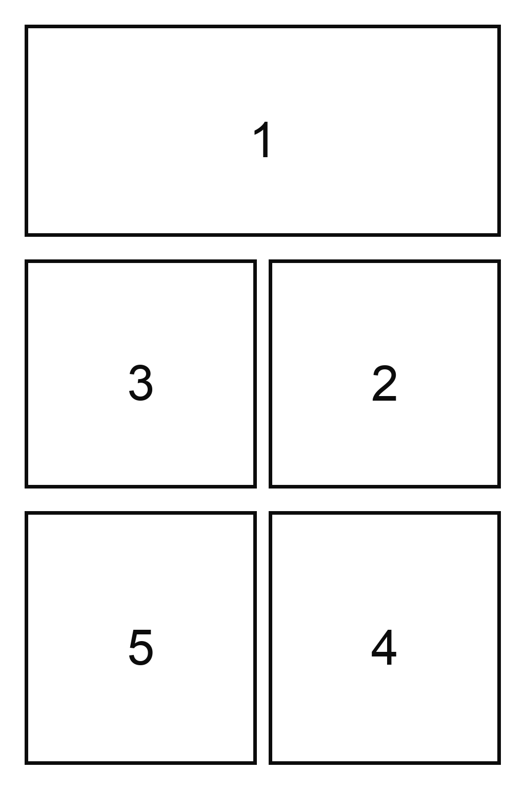

<table>
  <thead>
    <tr>
      <th style="text-align:center"><a href="README_ja.md">日本語</a></th>
      <th style="text-align:center"><a href="README.md">English</a></th>
    </tr>
  </thead>
</table>

# Codex 用マンガ生成スキル

Manga Generation は、ストーリー草稿・キャラクター資料・スタイルノートからカラーマンガページの企画・生成を行うための Codex スキルです。草稿をページごとのビート（場面展開）に展開し、同梱のマンガページテンプレートを選択し、コマごとの描画指示を作成し、`$imagegen` を使って各完成マンガページをコマ画像に分割したりコードで合成したりせず、1ページ全体として描画します。

## 機能

- 草稿・脚本・ストーリーコンセプトからマンガページを企画します。
- 3 つの展開モードをサポートしています：`Original`（原文）・`Slight Expansion`（軽度展開）・`Expansion`（展開）。
- 同梱のブランク原稿ベースおよびナンバリングされたマンガコマレイアウトから選択します。
- テンプレート選択・ページ目的・継続性ノート・描画指示・セリフ・効果音・フキダシ配置を含むページプランを生成します。
- パネル枠・コマの余白を保持したフルカラーのマンガページ全体を生成するよう `$imagegen` を誘導します。
- テンプレートとユーザー提供画像は、貼り付け素材や Python 合成用素材ではなく、役割を明示した画像生成用リファレンスとして扱います。
- 生成されたマンガページは `output/manga-pages/` に保存され、Git の管理対象外となります。

## テンプレートプレビュー

このスキルには、再利用可能なマンガページテンプレートが `skills/manga-generation/assets/Manga_Panel_Layout_Template/` に同梱されています。



## 要件

- スキルサポートを備えた Codex。
- 最終マンガページ画像を生成する際に `$imagegen` が利用可能であること。
- `generate_manga_templates.py` でテンプレート PNG を再生成する場合のみ、Pillow を含む Python 3 が必要です。

このリポジトリでは API キー・認証情報・環境変数は定義されていません。

## インストール

このリポジトリを clone し、同梱されているスキルフォルダを Codex の skills ディレクトリに配置してください：

```text
skills/manga-generation/ -> ~/.codex/skills/manga-generation/
```

必須のスキルエントリポイント：

```text
skills/manga-generation/SKILL.md
```

## 使い方

ストーリー草稿および関連する参考画像を用意して、Codex からスキルを呼び出してください：

```text
Use $manga-generation to make a 5-page colorful manga from my draft and references.
```

展開モードを指定することもできます：

```text
Use $manga-generation in Slight Expansion mode for this story draft.
```

デフォルトでは、スキルは以下の設定を使用します：

- 展開モード：`Original`
- 最大ページ数／画像数：`5`
- テンプレートフォルダ：スキルディレクトリからの相対パス `assets/Manga_Panel_Layout_Template/`
- 出力フォルダ：アクティブなワークスペースまたはリポジトリルートからの相対パス `output/manga-pages/`

スキルは生成前に各ページを企画します。各 `$imagegen` リクエストは、すべてのコマ・枠線・フキダシ・セリフ・効果音・ページ構成を含む完全なカラーマンガページを1枚生成する必要があります。

テンプレート PNG はページ構成の参照画像です。最終ページは Python で画像を配置したり元画像を貼り付けたりせず、テンプレート・ストーリープラン・ユーザー提供画像をもとに imagegen で描画します。

## 開発

以下のコマンドで、決定論的なブランク原稿ベース・生成済みパネルテンプレート・`template_manifest.json` を再生成できます：

```bash
python3 skills/manga-generation/scripts/generate_manga_templates.py
```

スクリプトの出力先：

```text
skills/manga-generation/assets/Manga_Panel_Layout_Template/
```

GitHub から公開できる状態を維持するため、スキルは `skills/manga-generation/` の下で自己完結するようにしてください。

## プロジェクト構成

```text
.
├── skills/
│   └── manga-generation/
│       ├── SKILL.md
│       ├── agents/openai.yaml
│       ├── assets/Manga_Panel_Layout_Template/
│       ├── references/
│       └── scripts/generate_manga_templates.py
├── AGENTS.md
├── LICENSE
└── README.md
```

## プライバシー

このスキルは認証情報を保存せず、外部サービスとの連携も定義していません。マンガ草稿・参考画像・生成されたページプラン・出力画像は、ユーザーが明示的に共有しない限り、アクティブな Codex ワークスペース内に保持されます。

## ライセンス

このリポジトリは MIT ライセンスの下で公開されています。[LICENSE](LICENSE) を参照してください。
