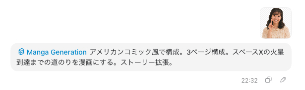
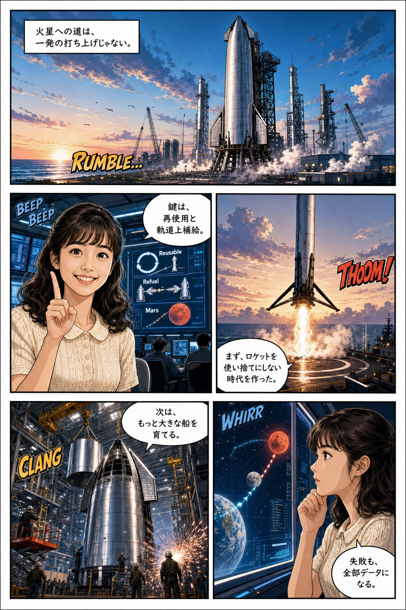
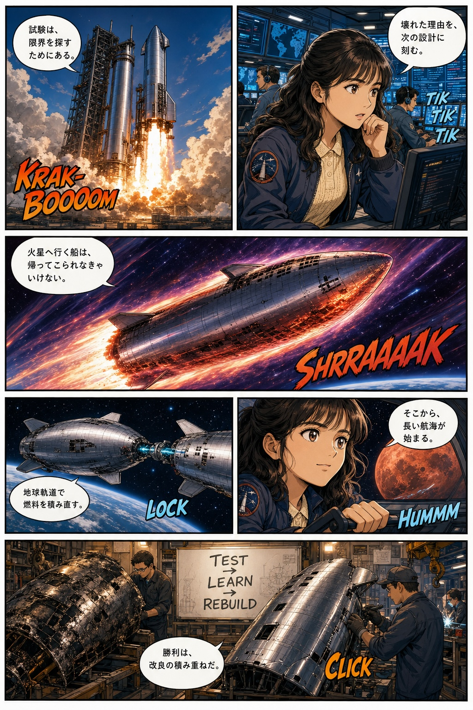

<table>
  <thead>
    <tr>
      <th style="text-align:center"><a href="README_ja.md">日本語</a></th>
      <th style="text-align:center"><a href="README.md">English</a></th>
    </tr>
  </thead>
</table>

# Codex 向けマンガ生成スキル

マンガ生成（Manga Generation）は、ストーリー草稿・キャラクターリファレンス・スタイルメモをもとに、カラフルなマンガページを企画・生成するための Codex スキルです。草稿をページごとのビートに展開し、同梱のマンガページテンプレートを選択し、コマごとの指示を作成し、`$imagegen` を使用して完成したマンガページを個別のコマ画像や Python による合成レイアウトではなく、1 枚のフルページとしてレンダリングします。

## 機能

- 草稿・脚本・ストーリーの前提からマンガページを企画します。
- `Original`（原文）、`Slight Expansion`（軽度拡張）、`Expansion`（拡張）の 3 つの展開モードをサポートします。
- 同梱のブランク原稿ベースと番号付きマンガコマレイアウトから選択します。
- テンプレートの選択、ページの目的、連続性メモ、作画指示、セリフ、効果音、フキダシ配置を含むページ計画を生成します。
- `$imagegen` に対して、パネルの境界線とコマ間の余白を保持した、完全フルカラーのマンガページを作成するよう誘導します。
- テンプレートおよびユーザー提供の画像は、貼り付けや Python 合成のアセットとしてではなく、画像生成のためのロールラベル付きリファレンスとして使用します。
- 生成されたマンガページは `output/manga-pages/` 以下に保存され、Git の管理対象外となります。

## テンプレートプレビュー

本スキルには、`skills/manga-generation/assets/Manga_Panel_Layout_Template/` 以下に再利用可能なマンガページテンプレートが同梱されています。


## 使用例

`demo_image/` ディレクトリには、サンプルのプロンプト画像と生成された出力結果が含まれており、期待されるワークフローと出力品質を確認できます。

プロンプト画像：



生成された出力：





## 動作要件

- スキルサポートを備えた Codex。
- 最終的なマンガページ画像を生成する際に `$imagegen` が利用可能であること。
- `generate_manga_templates.py` でテンプレート PNG を再生成する場合のみ、Pillow をインストールした Python 3 が必要です。

本リポジトリでは API キー・認証情報・環境変数は定義していません。

## インストール

このリポジトリをクローンし、同梱のスキルフォルダを Codex のスキルディレクトリにコピーしてください：

```text
skills/manga-generation/ -> ~/.codex/skills/manga-generation/
```

必須のスキルエントリポイントは以下のとおりです：

```text
skills/manga-generation/SKILL.md
```

## 使い方

ストーリー草稿と関連するリファレンス画像を用意して、Codex からスキルを呼び出します：

```text
Use $manga-generation to make a 5-page colorful manga from my draft and references.
```

展開モードを指定することもできます：

```text
Use $manga-generation in Slight Expansion mode for this story draft.
```

デフォルトでは、スキルは以下の設定を使用します：

- 展開モード：`Original`
- 最大ページ数 / 画像数：`5`
- テンプレートフォルダ：スキルディレクトリからの相対パス `assets/Manga_Panel_Layout_Template/`
- 出力フォルダ：アクティブなワークスペースまたはリポジトリルートからの相対パス `output/manga-pages/`

スキルは生成前に各ページを計画します。各 `$imagegen` リクエストは、すべてのコマ・境界線・フキダシ・セリフ・効果音・ページ構成を含む、完全なフルカラーのマンガページを 1 枚生成する必要があります。

テンプレート PNG はページのジオメトリを示すリファレンスにすぎません。最終ページは、Python による組み立てや画像の貼り付けではなく、テンプレート・ストーリープラン・ユーザーのリファレンス画像をもとに imagegen によって描画されます。

## 開発

以下のコマンドで、決定論的なブランク原稿ベース・生成済みパネルテンプレート・`template_manifest.json` を再生成できます：

```bash
python3 skills/manga-generation/scripts/generate_manga_templates.py
```

スクリプトの出力先：

```text
skills/manga-generation/assets/Manga_Panel_Layout_Template/
```

スキルを `skills/manga-generation/` 以下に自己完結した形で保持し、フォルダをコピーするだけでインストールできるようにしてください。

## プロジェクト構成

```text
.
├── demo_image/
│   ├── prompt-image.jpg
│   ├── generated-image1.jpeg
│   ├── generated-image2.jpeg
│   └── generated-image3.jpeg
├── skills/
│   └── manga-generation/
│       ├── SKILL.md
│       ├── agents/openai.yaml
│       ├── assets/Manga_Panel_Layout_Template/
│       ├── references/
│       └── scripts/generate_manga_templates.py
├── AGENTS.md
├── LICENSE
└── README.md
```

## プライバシー

本スキルは認証情報を保存せず、外部サービスとの連携も定義しません。マンガ草稿・リファレンス画像・生成されたページ計画・出力画像は、ユーザーが明示的に共有しない限り、アクティブな Codex ワークスペース内に留まります。

## ライセンス

本リポジトリは MIT ライセンスの下で公開されています。[LICENSE](LICENSE) を参照してください。